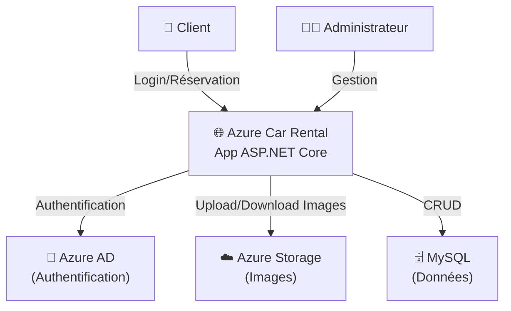
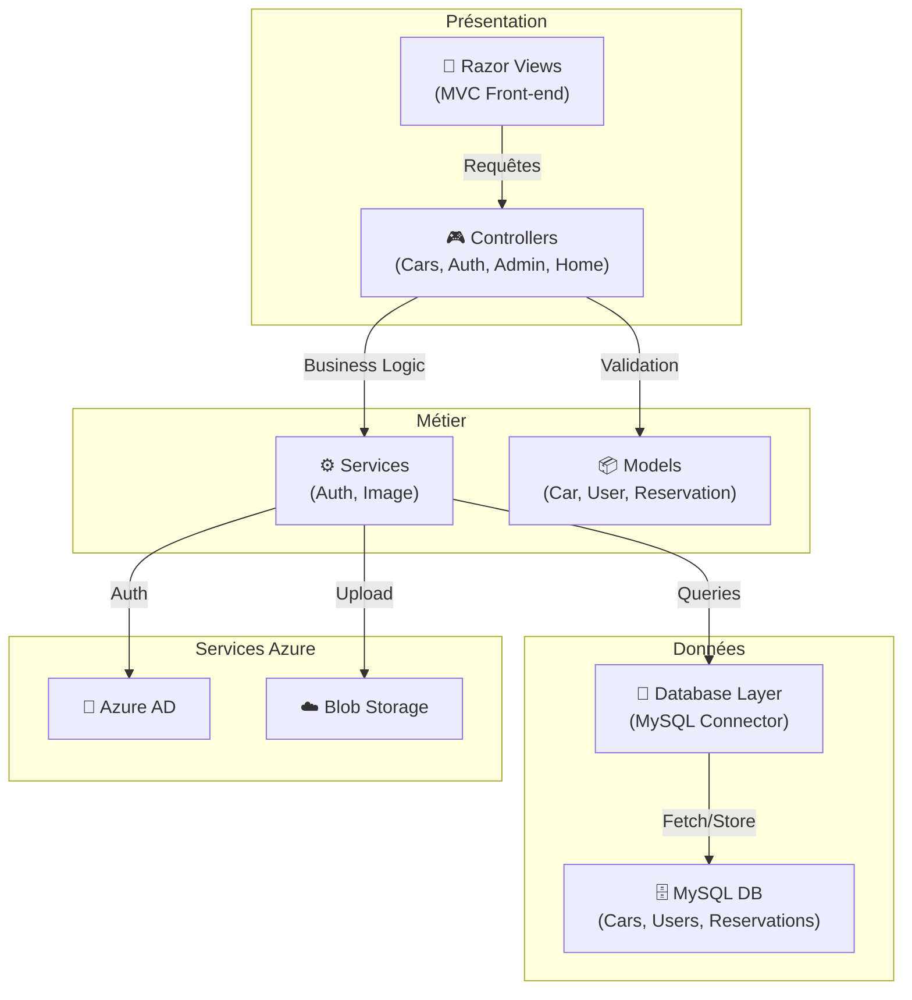
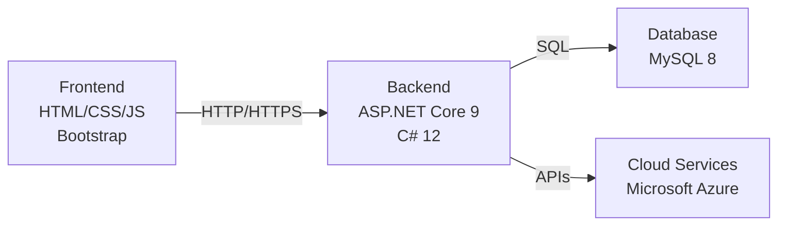
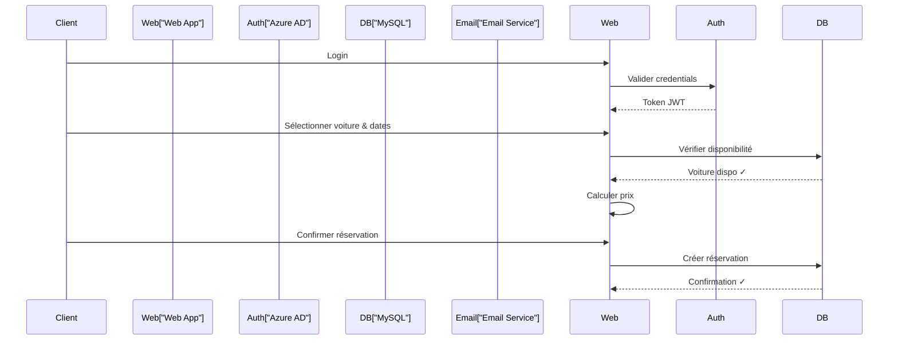

# 🚗 Azure Car Rental

> Une plateforme moderne de location de voitures construite avec ASP.NET Core et les services Azure

---

## 📋 Table of Contents

- [Vue d'ensemble](#vue-densemble)
- [Architecture système](#architecture-système)
- [Diagramme de contexte](#diagramme-de-contexte)
- [Diagramme d'architecture](#diagramme-darchitecture)
- [Features](#features)
- [Stack technique](#stack-technique)
- [Installation](#installation)
- [Configuration](#configuration)
- [Usage](#usage)
- [Structure du projet](#structure-du-projet)

---

## 🎯 Vue d'ensemble

**Azure Car Rental** est une application web complète de location de voitures qui offre :

- ✅ **Authentification sécurisée** avec Azure Active Directory
- ✅ **Gestion de flotte** avec stockage d'images sur Azure Blob Storage
- ✅ **Système de réservation** avec calcul automatique des prix
- ✅ **Notifications par email** via Azure Communication Services
- ✅ **Support multilingue** avec traduction automatique
- ✅ **Interface administrateur** pour gérer les voitures et les réservations

### Cas d'usage principaux

1. **Clients** : Parcourir les voitures, effectuer des réservations, gérer leur compte
2. **Administrateurs** : Gérer la flotte de voitures, suivre les réservations, visualiser les rapports
3. **Système** : Envoyer des confirmations par email, transférer les images vers le cloud

---

## 🏗️ Architecture système

### Diagramme de contexte

Le diagramme ci-dessous montre les interactions entre le système et les acteurs externes :



---

## 📐 Diagramme d'architecture

### Architecture en couches



---

## ✨ Features

### 🔐 Authentification & Sécurité

- Authentification Azure Active Directory (OAuth 2.0 / OpenID Connect)
- Support des sessions utilisateur
- Rôles (Client / Admin)
- Token-based security

### 🚗 Gestion de flotte

- Catalogue de voitures avec images
- Disponibilité en temps réel
- Tarification par jour
- Détails complets des véhicules

### 📅 Système de réservation

- Réservation en ligne
- Calcul automatique du prix
- Confirmation par email
- Gestion du calendrier

### 👨‍💼 Panneau administrateur

- Tableau de bord des réservations
- Création/édition de voitures
- Gestion de la flotte
- Rapports

---

## 💻 Stack technique



### Technos principales

| Couche               | Technologie            | Version |
| -------------------- | ---------------------- | ------- |
| **Langage**          | C#                     | 12+     |
| **Framework**        | ASP.NET Core           | 9.0     |
| **Base de données**  | MySQL                  | 8+      |
| **Connecteur DB**    | MySqlConnector         | 2.5.0   |
| **Frontend**         | Bootstrap 5, jQuery    | Latest  |
| **Authentification** | Microsoft Identity Web | 3.1.5   |
| **Cloud**            | Microsoft Azure        | Current |

### Services Azure utilisés

- 🔐 **Azure AD** - Authentification et gestion des identités
- ☁️ **Azure Blob Storage** - Stockage des images de voitures

- 🌍 **Azure Translator** - Traduction multilingue

---

## 📦 Installation

### Prérequis

- ✅ .NET 9 SDK ou supérieur
- ✅ MySQL 8 ou supérieur
- ✅ Visual Studio 2022 / VS Code
- ✅ Compte Azure actif
- ✅ Tenant Azure AD

### Étapes d'installation

#### 1. Cloner le projet

```bash
git clone https://github.com/yourname/AzureCarRental.git
cd AzureCarRental
```

#### 2. Restaurer les dépendances

```bash
dotnet restore
```

#### 3. Configurer la base de données

```bash
# Créer la base de données MySQL
mysql -u root -p < database-init.sql

# Ou laisser l'appli initialiser au démarrage (auto-initialization)
```

#### 4. Configurer les secrets

```bash
# Stocker les secrets localement
dotnet user-secrets init
dotnet user-secrets set "Azure:AzureAd:TenantId" "your-tenant-id"
dotnet user-secrets set "Azure:AzureAd:ClientId" "your-client-id"
dotnet user-secrets set "Azure:AzureAd:ClientSecret" "your-secret"
```

#### 5. Démarrer l'application

```bash
dotnet run
# Accéder à https://localhost:7177
```

---

## ⚙️ Configuration

### appsettings.json

```json
{
  "ConnectionStrings": {
    "Default": "Server=localhost;Port=3306;Database=carrental;User=root;Password=yourpassword;",
    "AzureStorage": "DefaultEndpointsProtocol=https;AccountName=..;AccountKey=..;..."
  },
  "Azure": {
    "AzureAd": {
      "Instance": "https://login.microsoftonline.com/",
      "TenantId": "YOUR_TENANT_ID",
      "ClientId": "YOUR_CLIENT_ID",
      "ClientSecret": "YOUR_CLIENT_SECRET",
      "CallbackPath": "/signin-oidc"
    },
    "Email": {
      "ConnectionString": "endpoint=https://...;accesskey=...",
      "SenderEmail": "noreply@carrental.com",
      "AdminEmail": "admin@carrental.com"
    }
  }
}
```

### Variables d'environnement

```bash
# Développement
ASPNETCORE_ENVIRONMENT=Development

# Production
ASPNETCORE_ENVIRONMENT=Production
AZURE_TENANT_ID=xxx
AZURE_CLIENT_ID=xxx
AZURE_CLIENT_SECRET=xxx
```

Voir [AZURE_AD_SETUP.md](AZURE_AD_SETUP.md) pour la configuration détaillée d'Azure AD.

---

## 🚀 Usage

### Navigation

```
🏠 Accueil (Public)
├── 🚗 Catalogue des voitures
│   └── Détails & Réservation
├── 🔐 Authentification
│   ├── Login
│   └── Register
└── 👤 Profil utilisateur
   └── Mes réservations

👨‍💼 Panneau Admin (Privé)
├── 📊 Tableau de bord
├── 🚗 Gestion des voitures
│   ├── Lister
│   ├── Créer
│   └── Éditer
└── 📋 Gestion des réservations
    └── Voir toutes les réservations
```

### Cas d'usage client

1. **Parcourir** : Accueil → Catalogue voitures
2. **Réserver** : Sélectionner une voiture → Choisir dates → Confirmer
3. **Payer** : Confirmation avec calcul du prix (nb jours × tarif/jour)
4. **Confirmation** : Email reçu avec détails

### Cas d'usage administrateur

1. **Gérer flotte** : Admin → Voitures → Ajouter/Éditer
2. **Suivre réservations** : Admin → Réservations → Voir tous les détails
3. **Uploader images** : Vers Azure Blob Storage via ImageService

---

## 📂 Structure du projet

```
AzureCarRental/
│
├── 📄 Program.cs                    # Configuration et initialisation
├── 📄 AzureCarRental.csproj         # Projet et dépendances
│
├── Controllers/                      # Contrôleurs MVC
│   ├── HomeController.cs            # Accueil
│   ├── CarsController.cs            # Catalogue & Réservation
│   ├── AuthController.cs            # Authentification
│   └── AdminController.cs           # Admin panel
│
├── Models/                           # Entités de données
│   ├── Car.cs                       # Voiture
│   ├── Reservation.cs               # Réservation
│   ├── User.cs                      # Utilisateur
│   └── ErrorViewModel.cs
│
├── Views/                            # Razor Templates
│   ├── Home/                        # Pages d'accueil
│   ├── Cars/                        # Catalogue & Détails
│   ├── Auth/                        # Login/Register
│   ├── Admin/                       # Panel administrateur
│   └── Shared/                      # Layout & Composants
│
├── Services/                         # Business Logic
│   ├── IAuthService.cs              # Auth métier
│   ├── AuthService.cs
│   ├── IAzureAuthService.cs         # Azure AD integration
│   ├── AzureAuthService.cs
│   ├── IImageService.cs             # Gestion des images
│   └── ImageService.cs
│
├── Data/                             # Accès aux données
│   └── Database.cs                  # MySQL operations
│
├── wwwroot/                          # Assets statiques
│   ├── css/
│   ├── js/
│   └── lib/                         # Bibliothèques
│
├── Properties/
│   └── launchSettings.json          # Ports et URLs
│
├── appsettings.json                 # Configuration
├── appsettings.Development.json
└── README.md                         # Documentation
```

---

## 🔄 Flux de données

### Réservation d'une voiture



---

## 📊 Base de données

### Schéma

```sql
-- Utilisateurs
Users (
  Id, Name, Email, Password, Role, CreatedAt
)

-- Voitures
Cars (
  Id, Brand, Model, Year, DailyRate, ImageUrl, IsAvailable
)

-- Réservations
Reservations (
  Id, CarId, CustomerName, CustomerEmail, StartDate, EndDate, TotalPrice
)
```

---

## 🔒 Sécurité

- 🔐 **Azure AD** pour l'authentification sécurisée (OAuth 2.0)
- 🔑 **Secrets Manager** pour gérer les credentials
- 🛡️ **HTTPS** obligatoire en production
- 📝 **Sessions sécurisées** avec HttpOnly cookies
- ✅ **Validation** des entrées sur client et serveur

---

## 📝 Logs et Monitoring

```csharp
// Logs automatiques via ILogger
app.Logger.LogInformation("ImageService initialized");
app.Logger.LogError("Database error: {error}", ex.Message);
```

---

## 🚀 Déploiement

### Azure App Service

```bash
# Publier sur Azure
dotnet publish -c Release

# Via Azure CLI
az webapp deployment source config-zip \
  --resource-group myResourceGroup \
  --name myAppServiceName \
  --src-path publish.zip
```

---

## 👥 Contribution

Les contributions sont bienvenues ! N'hésitez pas à :

- 🐛 Signaler des bugs
- 💡 Proposer des améliorations
- 🔧 Soumettre des pull requests

---

## 📄 Licence

MIT License - voir `LICENSE` pour plus de détails

---

## 📞 Support

Pour toute question ou assistance :

- 📧 Email: support@carrentalazure.com
- 🐛 Issues: GitHub Issues
- 💬 Discussions: GitHub Discussions

---

**Développé avec ❤️ en utilisant ASP.NET Core & Azure**
